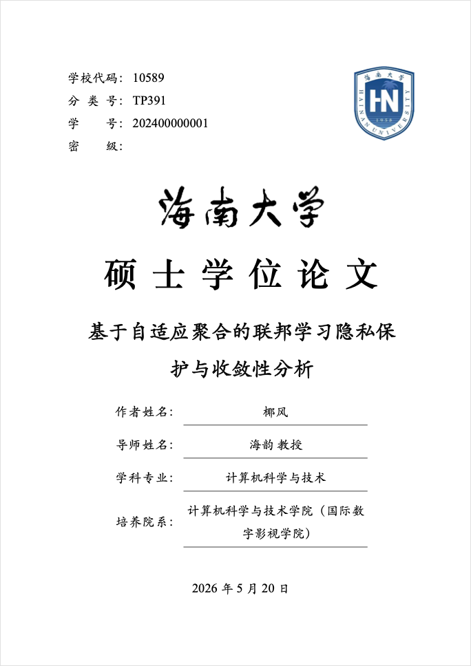
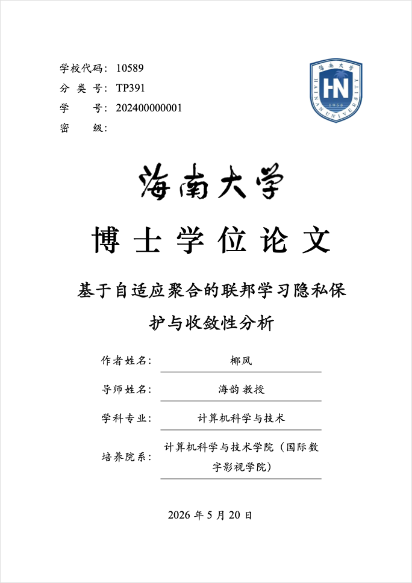
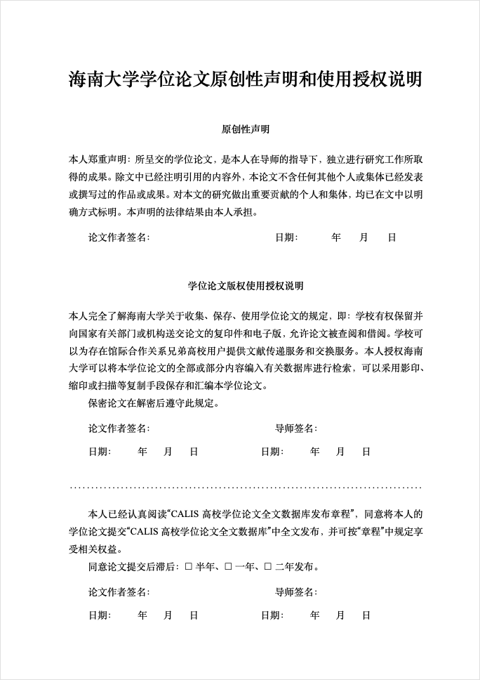
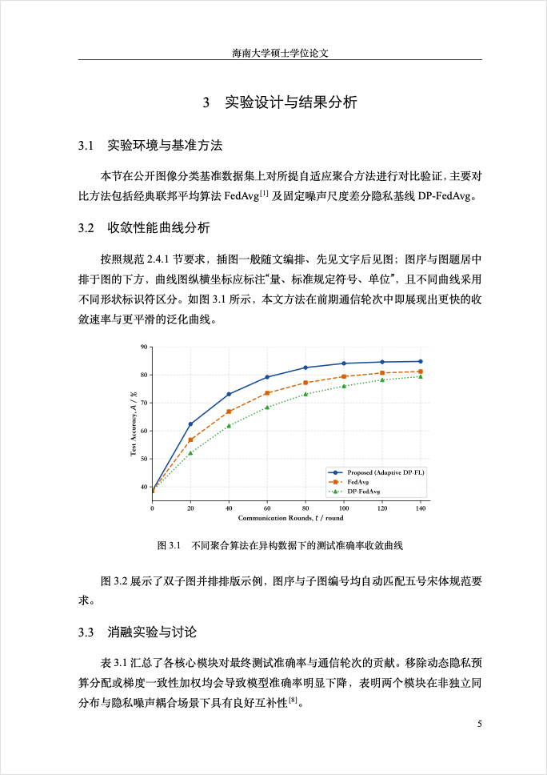

# HainuThesis — 海南大学研究生毕业论文 LaTeX 模板

> **海南大学硕士 / 博士学位论文 LaTeX 模板（Hainan University Graduate Thesis LaTeX Template，文档类 `hainanuthesis`）**
>
> 严格依据《**海南大学研究生学位论文撰写规范（修订）**》（海大党政办〔2023〕47 号）制作，支持 **Overleaf 在线免安装使用** 与 **Windows / macOS / Linux 本地编译**。

[](https://github.com/superyeda/HainuThesis/actions/workflows/build.yml)
[](LICENSE)
[](#快速上手3-分钟跑通)

---

## 排版效果预览

| 硕士封面 | 博士封面 | 原创性声明与授权页 | 正文、页眉页码与插图 |
| :---: | :---: | :---: | :---: |
|  |  |  |  |

---

## 为什么用这个模板？

- **严格对齐 2023 最新校级规范**：页边距（上 2.5 / 下 2.5 / 左 3.0 / 右 2.5 cm）、封面布局与透明底校徽/书法校名、原创性声明（含 CALIS 声明）、中英文摘要、目录、图表清单、符号表、四级标题、三线表与跨页续表、附录、成果页、致谢、书脊一步到位。
- **硕士 / 博士 / 盲审 一行切换**：改一个参数就能切换博士封面或**双盲送审版**（自动隐藏姓名、导师、学号、声明页、致谢，并清除 PDF 作者信息）。
- **内置全校 35 个学院官方英文译名**：按规范附录 B 自动映射，填完中文学院名后，英文封面院系名自动生成，不怕翻错。
- **开箱即用，不挑电脑不报错**：缺失商业字体（方正小标宋简体、楷体\_GB2312）时自动优雅回退，在 Overleaf 和任何操作系统上都能直接点编译出 PDF。
- **国标参考文献自动排版**：内置 `GB/T 7714-2015`（`gbt7714-numeric` 顺序编码制），支持右上角上标引用 `\cite{}` 和正文平齐引用 `\citeinline{}`。

---

## 快速上手（3 分钟跑通）

### 方式一：Overleaf 在线写（最推荐，不用装任何软件）

1. 点击本页右上角绿色按钮 **Code** → **Download ZIP** 下载压缩包。
2. 打开 [Overleaf](https://www.overleaf.com/)，点击 **New Project** → **Upload Project** 上传刚才的 `.zip`。
3. 点击左上角 **Menu**，将 **Compiler** 改为 **`XeLaTeX`**（⚠️ 这一步必须改，否则中文无法编译）。
4. 点击绿色 **Recompile** 按钮，右侧即可看到生成的毕业论文 PDF！

### 方式二：电脑本地写（Windows / macOS / Linux）

安装 [TeX Live](https://www.tug.org/texlive/)（或 MacTeX / TinyTeX）后，在终端执行：

```bash
git clone https://github.com/superyeda/HainuThesis.git
cd HainuThesis

# 编译硕士论文（默认输出 main.pdf）
latexmk -xelatex main.tex
# 或使用 Makefile 快捷命令：
make master      # 生成硕士版 main.pdf
make doctor      # 生成博士版 main-doctor.pdf
make anonymous   # 生成盲审版 main-anonymous.pdf
make clean       # 清理临时文件
```

> 使用 **VS Code + LaTeX Workshop** 的同学，直接打开本文件夹并用 `xelatex -> bibtex -> xelatex × 2`（或 `latexmk`）配方即可，项目已内置 [`latexmkrc`](latexmkrc)。

---

## 写论文只需要改哪几个文件？

不需要看懂 `.cls` 源码，日常写作只需修改以下 3 处：

1. **[`main.tex`](main.tex)**：填写你的论文题目、姓名、导师、学号、专业、学院、关键词和日期。
2. **[`chapters/`](chapters/)**：直接往对应的章节文件里写正文（摘要、第 1–4 章、附录、成果、致谢）。
3. **[`bib/references.bib`](bib/references.bib)**：把从知网 / Google Scholar 导出的 BibTeX 参考文献粘贴进去，在正文里用 `\cite{key}` 引用即可。

---

## 常用一键开关（改 `main.tex` 第一行即可）

打开 [`main.tex`](main.tex) 第一行 `\documentclass[...]{hainanuthesis}`，按需填入选项：

```latex
\documentclass{hainanuthesis}                              % 默认：硕士论文、电子审阅/提交版
\documentclass[degree=doctor]{hainanuthesis}               % 博士学位论文
\documentclass[anonymous=true]{hainanuthesis}              % 双盲评审版（自动隐去个人信息与致谢）
\documentclass[degree=doctor, anonymous=true]{hainanuthesis} % 博士盲审版
\documentclass[print=true]{hainanuthesis}                  % 双面装订打印版（封面/声明单面自动补空白背页）
\documentclass[tocdepth=3]{hainanuthesis}                  % 目录显示到三级标题（默认二级）
\documentclass[enabstractsize=normal]{hainanuthesis}       % 英文摘要改用 12pt（默认严格按规范 16pt/20pt）
```

### 元信息填写示例（在 `main.tex` 中）

```latex
\hainanusetup{
  title        = {你的中文论文题目},
  title*       = {Your English Thesis Title},
  author       = {你的姓名},
  author*      = {ZHANG San},
  supervisor   = {导师姓名~教授},
  supervisor*  = {LI Si},
  student-id   = {202400000001},
  clc          = {TP391},                                  % 中图分类号
  secret-level = {},                                       % 公开论文留空即可
  major        = {计算机科学与技术},
  major*       = {Computer Science and Technology},
  school       = {计算机科学与技术学院（国际数字影视学院）}, % 填规范附录 B 全称即可自动生成英文院系名
  date         = {2026 年 5 月 20 日},
  date*        = {May, 2026},
  calis-delay  = {none},                                   % CALIS 滞后发布勾选：none | half | one | two
  keywords     = {关键词一, 关键词二, 关键词三},
  keywords*    = {Keyword 1, Keyword 2, Keyword 3},
}
```

---

## 常见问题（FAQ）

<details>
<summary><b>1. 正式打印前如何启用规范指定的「方正小标宋简体」和「楷体_GB2312」？</b></summary>

因开源协议合规原因，本仓库不直接附带商业字体文件，缺失时会自动回退到系统宋体加粗/楷体且不报错。
正式提交前，将合法获取的 `FZXBSJW.TTF`（方正小标宋简体）与 `KaiTi_GB2312.ttf`（楷体\_GB2312）放入 [`fonts/`](fonts/README.md) 目录（Overleaf 用户直接上传到项目的 `fonts/` 文件夹），重新编译即可自动生效。
</details>

<details>
<summary><b>2. 英文封面的学院名称没自动显示，或者我的学院改名了怎么办？</b></summary>

在 `\hainanusetup` 中直接加上一行 `school* = {School of ...},` 即可手动覆盖自动映射。完整映射表见 [`hainanuthesis-schools.def`](hainanuthesis-schools.def)。
</details>

<details>
<summary><b>3. 怎么单独生成论文书脊用于打印店装订？</b></summary>

取消 [`main.tex`](main.tex) 末尾 `\makespine` 一行的注释，编译后会在末尾生成一页符合规范 3.3 节（距上下边界 3 cm、竖排题目/姓名/海南大学）的独立书脊页。
</details>

<details>
<summary><b>4. 印刷与装订有什么要求？</b></summary>

按规范 3.10 节：中文摘要之前（中英文封面、原创性声明）单面印刷，自中文摘要起双面印刷；硕士封面封底用 180g 浅蓝色羊皮纸，博士用 180g 浅红色羊皮纸，热胶装订。如整本直接发给打印店双面打印，建议编译时开启 `print=true`。
</details>

<details>
<summary><b>5. 我是法学院或人文社科专业，格式要求不太一样怎么办？</b></summary>

本模板默认遵循研究生院全校通用规范（阿拉伯数字标题 `1 / 1.1 / 1.1.1 / 1.1.1.1` + `GB/T 7714-2015` 文后参考文献）。若所在学院要求中文序号（一、（一）、1.）或页下脚注引用体系，请对照本学院最新细则微调，也欢迎提 Issue / PR 共建学院变体支持！
</details>

---

## 项目结构

```text
HainuThesis/
├── main.tex                   # 论文主入口（填个人信息、开关选项、引入章节）
├── hainanuthesis.cls          # 核心格式类文件（一般无需修改）
├── hainanuthesis-schools.def  # 全校 35 个学院中英文官方译名映射表
├── chapters/                  # 摘要、符号表、正文各章、附录、成果、致谢
├── bib/references.bib         # GB/T 7714-2015 参考文献库
├── figures/                   # 论文插图存放目录
├── assets/                    # 海南大学校徽与书法校名透明底图
├── fonts/                     # 可选自定义字体目录（见 fonts/README.md）
├── Makefile & latexmkrc       # 一键编译配置（支持本地与 Overleaf）
└── .github/workflows/build.yml # GitHub Actions 自动编译检查
```

---

## 欢迎贡献 & 免责声明

- 如果这个模板帮到了你，欢迎点个 **Star ⭐** 让更多海南大学研究生同学搜到它！发现格式细节偏差或有改进建议，欢迎提 Issue 或 Pull Request。
- 本项目为非官方开源模板，代码采用 [MIT License](LICENSE) 开源；最终盲审及归档提交前，请务必对照当年海南大学研究生院及所在学院的最新撰写规范逐页核对。
- `assets/` 中的海南大学校徽与校名标识版权归**海南大学**所有，仅供海南大学师生撰写学位论文排版使用，请勿用于任何商业用途。
